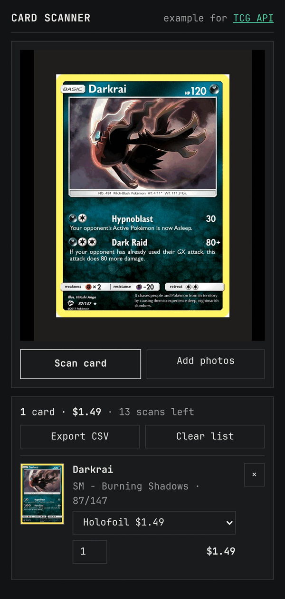

# TCG API card scanner example

Scan a stack of trading cards with your phone's camera and get a priced list you can export.

Point the camera at a card, graded slab or sealed product and tap **Scan card**. Each photo is read
in the background while you move on to the next one. The list shows every card with its printing
and market price, keeps a running total, and exports to CSV.



It is an example for the [TCG API](https://tcgapi.dev) card scanner endpoint,
[`POST /v1/identify`](https://tcgapi.dev/api/identify/), built with Next.js and no other
dependencies.

## Run it

You need Node 20.9 or newer and a TCG API key. A [free key](https://tcgapi.dev/signup/) comes with
25 scans.

```bash
git clone https://github.com/gordy-ftw/tcgapi-card-scanner-example.git
cd tcgapi-card-scanner-example
npm install
cp .env.example .env        # then put your key after TCGAPI_KEY=
npm run dev                 # http://localhost:3000
```

Browsers only allow the live camera on HTTPS or localhost. To use your phone on the same Wi-Fi, run
`npx next dev --experimental-https -H 0.0.0.0` and open `https://<your computer's address>:3000`.
Without the live camera the **Add photos** button still works, and on a phone it can open the camera.

## Put it online

[](https://vercel.com/new/clone?repository-url=https%3A%2F%2Fgithub.com%2Fgordy-ftw%2Ftcgapi-card-scanner-example)

Two environment variables decide who pays for the scans:

| `TCGAPI_KEY` | `ACCESS_CODE` | Who can scan |
|---|---|---|
| not set | | Each visitor types their own API key. Safe to put online as it is. |
| set | set | Your key pays. Visitors must type the access code first. |
| set | not set | Your key pays for anyone who can reach the app. Use this on your own computer only. |

In your own product, replace the access code with your login and a per-user limit.

## How it works

| File | What it does |
|---|---|
| `app/scanner.tsx` | The page: camera, scan queue, the list, the total and the CSV export. |
| `app/api/scan/route.ts` | Forwards one photo to `POST /v1/identify?include=prices`. |
| `app/api/prices/[id]/route.ts` | Prices for a card the user picked: `GET /v1/cards/{id}/prices`. |
| `lib/tcgapi.ts` | Adds the API key on the server, so it never reaches the browser. |

1. The page shrinks each camera frame or photo to a JPEG of at most 2048 px, which keeps the
   collector number and set code readable, and sends it to `/api/scan`.
2. The server adds the `X-API-Key` header and forwards the photo to the API.
3. The API reads what is printed on the card (name, collector number, set, edition stamp, foil,
   and the grade on a slab) and matches it against its catalog.
4. The page handles the answer according to its `status`:

| `status` | What the page does |
|---|---|
| `matched` | Exactly one card fits. Adds it to the list with the printing the photo points to. |
| `ambiguous` | Several versions fit. Lists them so the user picks one, then fetches its prices. |
| `retake` | The photo is blurred, cut off or has glare. Shows what to fix, and any cards found from the readable parts. |
| `not_found` | Nothing in the catalog matches what was read. |
| `unsupported` | A game or language the catalog does not list. |

The list is kept in the browser's storage, so it survives a reload. Photos are not kept.

## What it costs

Each photo the API reads uses one scan, including a photo it asks you to retake. Every account
gets 25 free scans once; after that, prepaid packs cost 1.5¢ to 0.8¢ per scan and never expire.
Scans are separate from your plan's daily request limit and work on every plan, Free included.
Fetching prices for a card picked from an ambiguous scan is one ordinary API request.
Purchased scans can be used commercially on every plan. See
[pricing](https://tcgapi.dev/pricing/#scans) and
[data licensing](https://tcgapi.dev/legal/licensing/#photo-identification-scans).

## Tests

```bash
npx playwright install chromium
npm test
```

The tests drive the app in a browser with a fake camera against a mock API (`e2e/mock-api.mjs`),
so they spend no scans.

## Notes

- **Card images.** The list shows the image URL the API returns. Card artwork belongs to the game
  publishers; whether to display it in your product is your call.
- **If your app knows the game,** add `&game=<slug>` to the identify call in
  `app/api/scan/route.ts`. It narrows the search. Slugs come from `GET /v1/games`.

## More

- [Card scanner guide](https://tcgapi.dev/use-cases/card-scanner/): how the scan works, accuracy, cost
- [Identify reference](https://tcgapi.dev/api/identify/): every field, status and error
- [Trading card recognition APIs compared](https://tcgapi.dev/blog/card-recognition-apis-compared/)
- SDKs: [JavaScript/TypeScript](https://github.com/gordy-ftw/tcgapi-js), [Python](https://github.com/gordy-ftw/tcgapi-python)

MIT licensed.
